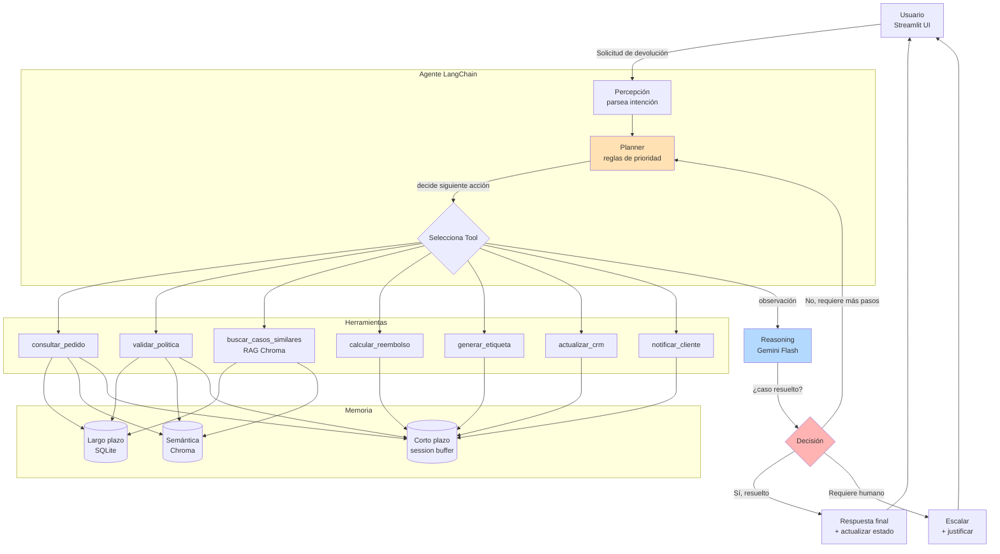

# Agente TechStore Returns

Agente funcional que automatiza el proceso de devoluciones de una tienda de tecnología ficticia (TechStore), integrando herramientas de **consulta, escritura y razonamiento**, memoria de corto/largo plazo, memoria semántica (RAG) y un planner con reglas de decisión priorizadas y justificadas.

Proyecto desarrollado para la Evaluación Parcial N°2 de **Ingeniería de Soluciones con IA (ISY0101)** — Duoc UC.

## Qué es

El agente recibe una solicitud de devolución (por ejemplo, "quiero devolver el pedido PED-001"), consulta el pedido y el historial del cliente, valida la política de devoluciones, busca casos previos similares por significado (no por palabra exacta) y decide de forma autónoma entre **aprobar**, **escalar** o **pedir más información**, ejecutando en consecuencia el reembolso, la etiqueta de devolución, la actualización del CRM y la notificación al cliente.

### Lo que SÍ hace / lo que NO hace
Ver [`docs/alcance.md`](docs/alcance.md).

## Arquitectura y orquestación



Diagrama ampliado y flujo de decisión regla-por-regla en [`docs/diagrama_orquestacion.md`](docs/diagrama_orquestacion.md).

### Decisión de diseño: flujo híbrido
`procesar_solicitud()` (en `agent/core.py`) ejecuta siempre la misma secuencia de tools y deja que el **planner determinístico** decida — es predecible, trazable y no depende de Internet. `crear_agente()` arma además un `AgentExecutor` de LangChain con el LLM (Gemini Flash) para razonamiento abierto. Esta separación garantiza que las 6 reglas de negocio se evalúen siempre de la misma forma (requisito de auditabilidad) mientras se conserva la capacidad de razonamiento libre del LLM para preguntas abiertas del cliente.

## Las 7 tools

| Tool | Tipo | Entrada | Salida |
|---|---|---|---|
| `consultar_pedido` | Consulta | `pedido_id` | pedido + historial del cliente |
| `validar_politica` | Consulta | `pedido_id` | `{elegible, razon, dias_desde_compra}` |
| `buscar_casos_similares` | Razonamiento (RAG) | `texto` | fragmentos de políticas/casos similares |
| `calcular_reembolso` | Escritura | `pedido_id, tipo` | `{monto, moneda}` |
| `generar_etiqueta` | Escritura | `pedido_id` | `{codigo, url}` |
| `actualizar_crm` | Escritura | `pedido_id, estado, nota` | `{ok}` |
| `notificar_cliente` | Escritura | `cliente_id, mensaje` | `{ok, canal}` |

Contratos completos en [`docs/tools.md`](docs/tools.md) y reglas de decisión en [`docs/reglas.md`](docs/reglas.md).

## Memoria

- **Corto plazo** (`agent/memory/short_term.py`): `ConversationBufferMemory` de LangChain, vive en `st.session_state` durante la sesión de Streamlit.
- **Largo plazo** (`agent/memory/long_term.py`): tabla `historial_cliente` en SQLite — persiste decisiones entre sesiones y permite reconocer clientes recurrentes.
- **Semántica / RAG** (`scripts/index_politicas.py`, `agent/tools/buscar_casos.py`): la política de devoluciones y casos previos se indexan como embeddings en **Chroma** (`sentence-transformers/all-MiniLM-L6-v2`), permitiendo recuperar contexto por significado y no por coincidencia exacta de palabras.

## Planificación y decisión adaptativa

El `planner` (`agent/planner.py`) aplica 6 reglas de negocio en estricto orden de prioridad (la primera que se cumple decide y detiene la evaluación):

1. No elegible → **escalar**
2. Monto > $100.000 → **solicitar_aprobacion**
3. ≥3 devoluciones en 90 días → **escalar_fraude**
4. Cliente recurrente y monto < $50.000 → **aprobar_preferente**
5. Falta información → **solicitar_info**
6. Caso estándar → **aprobar_estandar**

Esto demuestra **replanificación**: el mismo pedido (p. ej. `PED-001`) puede cambiar de `aprobar_estandar` a `aprobar_preferente` una vez que el cliente tiene historial registrado en memoria de largo plazo.

## Instalación y ejecución (reproducible desde cero)

```bash
# 1. Clona el repositorio
git clone https://github.com/TU_USUARIO/techstore-returns-agent.git
cd techstore-returns-agent

# 2. Entorno virtual
python -m venv .venv
source .venv/bin/activate        # Windows: .venv\Scripts\activate

# 3. Dependencias
pip install -r requirements.txt

# 4. Variables de entorno
cp .env.example .env
# Edita .env y pega tu GOOGLE_API_KEY (gratis en https://aistudio.google.com/apikey)

# 5. Datos mock + base de datos
python scripts/generate_mock_data.py
python -m scripts.seed_data

# 6. Memoria semántica (descarga el modelo de embeddings la primera vez, ~80 MB)
python -m scripts.index_politicas

# 7. Tests
pytest tests/ -v

# 8. Interfaz
streamlit run app.py
```

Abre `http://localhost:8501` y prueba los casos: `PED-001` (estándar), `PED-015` (fuera de plazo) y `PED-022` (alto valor).

> El flujo principal (`procesar_solicitud`) **no depende de Gemini**: funciona íntegramente con las tools y el planner, por lo que la demo sigue funcionando aunque falle la conexión o la cuota del LLM.

## Ejemplos de uso

```python
from agent.core import procesar_solicitud

procesar_solicitud("PED-001")  # -> accion: aprobar_estandar
procesar_solicitud("PED-015")  # -> accion: escalar (fuera de plazo, 45 días)
procesar_solicitud("PED-022")  # -> accion: solicitar_aprobacion (monto > $100.000)
```

## Pruebas

```bash
pytest tests/ -v
```

Cubre: las 7 tools, memoria de largo plazo, planner (6 reglas) y flujo end-to-end (incluye caso de pedido inexistente). Evidencia guardada en [`evidence/pytest_output.txt`](evidence/pytest_output.txt).

## Estructura del repositorio

```
├── agent/
│   ├── core.py              # Orquestador (procesar_solicitud, crear_agente)
│   ├── planner.py            # Reglas de decisión
│   ├── memory/                # Memoria corto/largo plazo
│   └── tools/                 # Las 7 tools
├── config/settings.py        # Umbrales y configuración central
├── scripts/                   # Generación/carga de datos, indexación Chroma
├── data/                       # CSV mock, políticas, SQLite (gitignored), Chroma (gitignored)
├── docs/                       # Alcance, contratos, reglas, diagramas
├── tests/                      # pytest (tools, planner, e2e)
├── evidence/                   # Screenshots y evidencia de pruebas
├── informe/                    # Informe técnico (PDF/Word)
└── app.py                      # Interfaz Streamlit
```

## Declaración de uso de IA

| Herramienta | Uso | Validado por |
|---|---|---|
| Gemini Flash (`gemini-3.8-flash`) | Motor LLM del agente (razonamiento del `AgentExecutor`) | Equipo completo |
| Claude (Anthropic) | Generación del andamiaje de código siguiendo la guía paso a paso del curso, redacción de README y diagramas, estructura del informe | Equipo completo (revisado y validado antes de entregar) |

Las conclusiones, justificaciones técnicas y reflexiones individuales del informe fueron redactadas por el equipo **sin apoyo de IA**, conforme a las indicaciones de la pauta de evaluación.

## Referencias (formato APA)

Chase, H. (2022). *LangChain* (versión 0.3) [Software]. GitHub. https://github.com/langchain-ai/langchain

Google. (2024). *Gemini API documentation*. Google AI for Developers. https://ai.google.dev/gemini-api/docs

Chroma. (2023). *Chroma: the open-source embedding database* [Software]. https://www.trychroma.com

Streamlit Inc. (2023). *Streamlit documentation*. https://docs.streamlit.io

Reimers, N., & Gurevych, I. (2019). Sentence-BERT: Sentence embeddings using Siamese BERT-networks. En *Proceedings of the 2019 Conference on Empirical Methods in Natural Language Processing (EMNLP-IJCNLP)* (pp. 3982–3992). Association for Computational Linguistics. https://doi.org/10.18653/v1/D19-1410

Russell, S., & Norvig, P. (2021). *Artificial intelligence: A modern approach* (4.ª ed.). Pearson.
