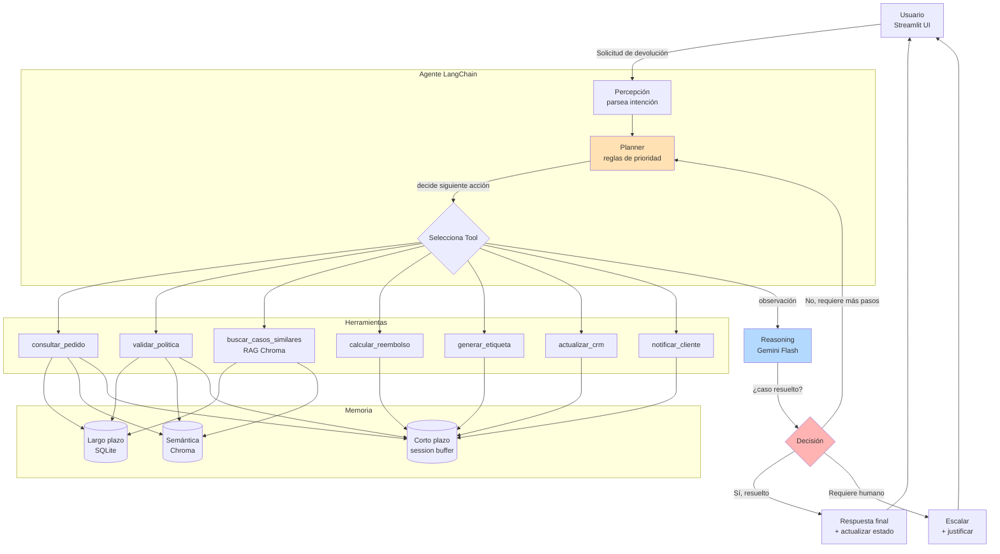
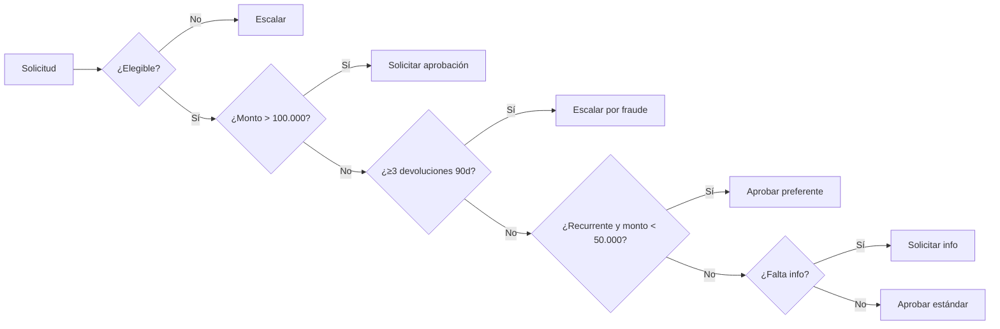

# Diagrama de orquestación del agente

## Cómo leer el diagrama
1. El usuario escribe su solicitud en la interfaz Streamlit.
2. El agente la percibe y el **planner** aplica las 6 reglas de negocio en orden de prioridad.
3. Según la regla activada, se seleccionan y ejecutan una o más **tools** (consulta, escritura o razonamiento/RAG).
4. Cada tool lee o escribe en alguna de las tres capas de **memoria** (corto plazo, largo plazo en SQLite, semántica en Chroma).
5. El resultado vuelve como observación; si el caso está resuelto, se entrega una respuesta final (aprobación) o se escala a un humano con justificación trazable.

## Flujo de decisión (replanificación)

